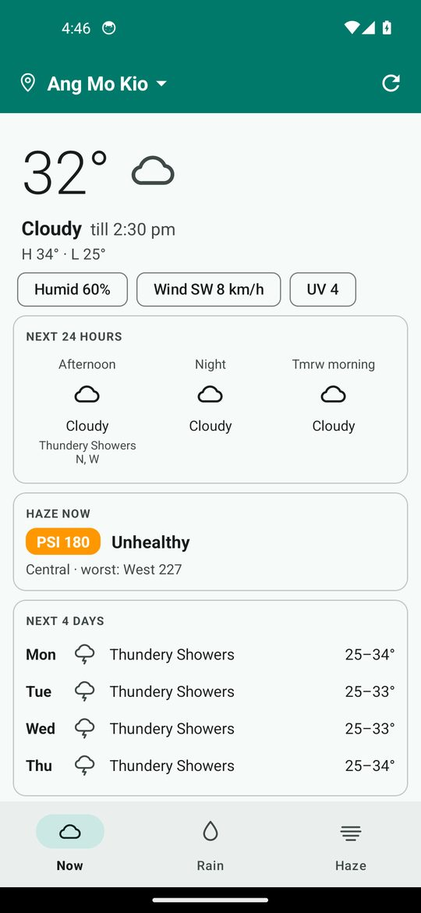
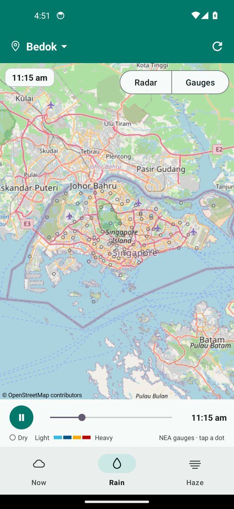
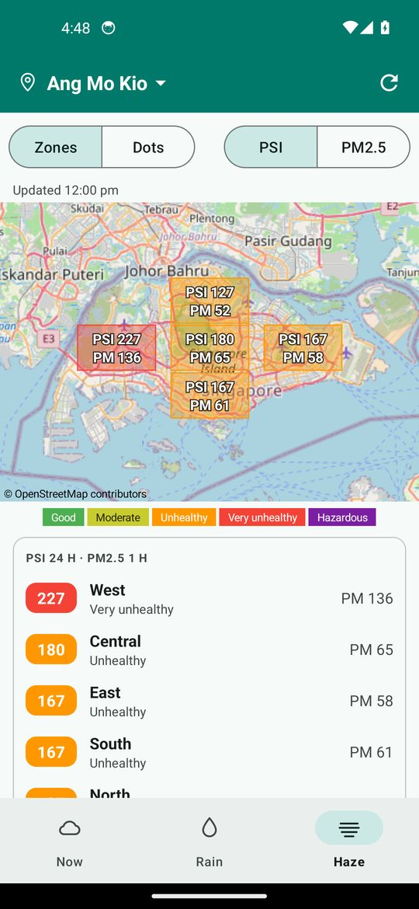

# Haze Map SG

A Singapore weather app for Android: today's forecast, a rain map you can play back
over the past two hours, and haze (PSI and PM2.5) with a history chart.
It uses free public data. No account or API key. Location is optional and asked only when you tap “Use my location”.

| Now | Rain (playing back) | Haze |
|---|---|---|
|  |  |  |

*Screenshots are from the CI emulator with live data. Dark mode: [Now](docs/screenshots/now-dark.jpg).*

## What it does

**Now** — for the area you pick (47 NEA forecast areas, default Ang Mo Kio; tap the name at the top):
temperature, condition and when that forecast ends, high and low, humidity, wind, UV,
the next 24 hours by period, a haze summary for your region, and the next four days.
Tap the area name, then “Use my location”, to choose the nearest forecast area.

**Rain** — a map of where it is raining, with a play button and a slider for the past two hours.
A switch at the top right picks the picture:

| | Radar | Gauges |
|---|---|---|
| Shows | rain clouds, as a radar picture | one dot per NEA rain gauge (90), coloured by how hard it rained |
| Steps | 10 minutes (13 frames) | 5 minutes (24 frames) |
| Source | [RainViewer](https://www.rainviewer.com/) | NEA via data.gov.sg |
| Detail | coarse (about 1.2 km per pixel) | exact readings; tap a dot for its value |

It plays by itself and starts over when it reaches the newest picture. Press Pause or drag the slider to stop it;
it stays still until you press Play. It does not start by itself when the phone has animations turned off.
Zoom out to watch rain coming across the Strait.
Radar pictures are saved on the phone (about 1 MB). The app downloads only the pictures it does not have yet,
and with no network it plays the last two hours it saved, with a note saying how old they are.
Pictures older than two hours are deleted when new ones arrive.

**Haze** — NEA's five regions as dots coloured by PSI,
both PSI and PM2.5 shown on each dot, a ranked list, and a line chart of each region's readings.
The chart is built from readings the app saves on your phone each time it fetches, so it grows
the more you open the app. Nothing is sent anywhere.

**My places** — Singapore is home and has every feature. Tap the globe at the top to open a list of
other cities you saved. Each shows its temperature and weather; tap one for its page with the next four
days, the humidity and the wind. The star on a page saves or removes it. Use "Add a place" to search any city in the world.
City weather is from [Open-Meteo](https://open-meteo.com/) (free for apps without ads or subscriptions).

**Updates** — the app updates itself. When it opens it asks GitHub (at most every 6 hours) for the newest
release. If that is newer, a banner at the top says so and the app downloads it: by itself on Wi-Fi, or when
you tap Update on mobile data. It checks the file is this app, newer, and signed with the same key, then
installs it when you leave the app, so it never closes in front of you. On Android 12 and newer that needs no
tap. On older Android, or the first time, Android asks you once (allow "Install unknown apps", then Update).
Install in the banner does it right away. The X skips that version. If something fails, the banner says why
and offers Try again, or Download to get the file in your browser. The request sends nothing about you
except what any web request does.

**Widgets** — three home screen widgets with a sky that matches the weather. Each one shows Singapore
or one of your saved cities. It has a clock and the date, the temperature, the weather now, the place
name, and a pill with the time of the reading:

| Widget | Size | Layout |
|---|---|---|
| Square | 2x2 | clock and picture on top; temperature, weather, place, pill and its time below |
| Wide | 4x2 | big clock and big picture; "Bedok · PSI at 2:00 pm" under the weather |
| Strip | 4x1 | clock, picture, weather and pill in one row |

| Shows | Temperature | Weather | Pill | Clock |
|---|---|---|---|---|
| Singapore | average of all NEA stations | NEA forecast for your area | PSI, in its band colour | Singapore time |
| A saved city | the city's temperature | the city's weather | humidity | the city's own time |

When you add a widget, a screen asks what it should show: Singapore or a city from My places, and the
calendars for the next-event line. Tap a place, or Done to keep the one marked. To change it later,
long-press the widget and open its settings (Android 12 and newer); on older Android, remove the widget
and add it again. Each widget keeps its own place, so a Square can show Singapore while a Wide shows
Tokyo. Tapping a city widget opens that city's page. A widget keeps its city even if you take the city
off My places.

**Next event** — the Wide and Square widgets can show your next calendar event, such as "3 pm Lunch".
On the widget's screen, open Calendars, allow calendar access, and tick the calendars to use. The list
starts with the ones your Calendar app shows; a calendar switched off in its account has no events on
the phone and cannot be ticked. One list serves every widget. With no event in the next week there is no
line at all.

The line shows the first day that still has an event. On that day a timed event beats an all-day one,
and one about to start beats one that has been running a while. Cancelled and declined events are
skipped. Times follow the phone's clock, like your Calendar app. Tap the line to open the event in your
Calendar app. It changes as an event starts and ends, and when a calendar changes.

It is only the event: no weather, and no network. The app reads each event's title and time on the
phone, and never sends them anywhere.

**Short widgets** — a home screen app decides how tall a 4x2 widget is: about 220 dp on a Pixel, about
140 dp on some other phones. The widget asks for its height and packs its text to fit. A short Wide drops
the date first, then the event line, then shrinks the clock and the temperature. A Square has less room,
so it shows the event only from about 144 dp up. A larger text size in Settings counts as less height.
The widgets cannot be resized, so they settle on a size when you add them.

The sky colour and its picture follow the weather: sunny, partly cloudy, cloudy, rain, thunderstorm,
haze and windy. In Singapore, clear weather from 7 pm to 7 am shows a night sky with the moon, and
partly cloudy shows clouds. A city is dark when the sun is down there. The picture moves for about
10 seconds each time the home screen shows it, then rests, to save battery. With animations turned off,
and on some home screen apps, it stays still. The clock is the phone's own and keeps time by itself.

Long-press the home screen, pick Widgets, then Haze Map SG. The weather refreshes about every 30 minutes
(the fastest Android allows), even when the app is closed, and when you change area in the app. A city
widget asks Open-Meteo for its city only, and a Singapore widget asks NEA only.
The sky looks the same in light and dark mode.

## Data, and what to expect

| Data | Source | Terms |
|---|---|---|
| Forecasts, temperature, humidity, wind, UV, rain gauges, PSI, PM2.5 | [NEA via data.gov.sg](https://data.gov.sg/) | Singapore Open Data Licence 1.0 |
| Rain radar pictures | [RainViewer](https://www.rainviewer.com/api.html) free API | personal use, credit required |
| Base map | OpenStreetMap, through osmdroid | © OpenStreetMap contributors |

- **NEA allows 6 calls per 10 seconds without a key.** The app keeps to 5. A cold start of the Now tab
  needs 9 calls, so it takes 10 to 15 seconds to fill in completely. The last saved copy of everything
  is shown at once, and each card updates as its data arrives.
- Offline, the app shows the last saved forecast, haze and rain-gauge readings, and map tiles you
  have already viewed. Radar pictures are not saved: the radar shows "Couldn't load the radar. Tap to retry."
- The app fetches only while it is open. There is no background work.
- Times are always Singapore time.
- The area picker sets the forecast region by the nearest NEA region label, which is an approximation
  of NEA's actual region borders.

## Install

1. Open the latest entry under **Releases**, on your phone.
2. Download `HazeMapSG-1.0.N.apk` and open it. Allow installing from your browser if asked.

Builds from `main` are releases; builds from other branches are pre-releases.

**If Android says "App not installed":** the APKs are signed with a temporary key that changes
with every build (no signing key is configured), and Android will not update an app with a
different key. Uninstall the old Haze Map SG first. Its saved haze history is lost.
To make updates install over the top, add the two secrets below.

### Fixed signing key (optional)

Add two repository secrets and every build is signed with your key:

- `SIGNING_KEYSTORE_B64` — your PKCS#12 keystore, base64-encoded (key alias `hazemap`).
- `SIGNING_STORE_PASSWORD` — its password.

Keep a backup of the keystore. If you lose it, installed copies cannot be updated.

## Build and test

Builds run on GitHub Actions (`.github/workflows/android.yml`):

1. **build** runs the unit tests, builds the release APK and publishes it as a GitHub release.
2. **smoke** installs the APK on an Android 14 emulator (Pixel 5), opens every tab with live data,
   taps through the area picker, the Radar/Gauges switch and Play, switches dark mode and rotation
   while open, and goes offline. Screenshots and a log are kept as the `smoke-screenshots` artifact.
   It never blocks a release.

Locally: `./gradlew testDebugUnitTest assembleRelease`; the APK lands in `app/build/outputs/apk/release/`.

The 37 unit tests include the parsers, run against real NEA and RainViewer responses saved in
`app/src/test/resources/fixtures`. The app reads three launch extras so the smoke test can reach a
screen directly: `tab` (`now`, `rain`, `haze`), `source` (`radar`, `gauges`) and `zoom`.

The emulator is a Pixel, whose home screen gives widgets plenty of height, so the smoke test also draws the
widgets at exact short heights inside the app (the `widget_preview` extra) and keeps those pictures as
`fit-*.png`. To run only that part, start the workflow by hand with the input `only` set to `widget-fit`.

## Code map

| File | Job |
|---|---|
| `MainActivity.kt` | tabs, area picker; builds the map tabs on first visit |
| `NowScreen.kt`, `RainScreen.kt`, `HazeScreen.kt` | one per tab |
| `RadarOverlay.kt`, `GaugeOverlay.kt` | draw radar tiles and gauge dots on the osmdroid map |
| `Http.kt` | HTTP, and the rate limiter for the data.gov.sg limit |
| `WeatherRepository.kt`, `JsonCache.kt` | fetch with a disk cache; saved copies for instant paint |
| `NeaParsers.kt`, `NeaApi.kt` | parse the responses (pure, no Android) |
| `WeatherLogic.kt` | condition icons, forecast sentences, wind, rain levels, tile maths |
| `HistoryDb.kt`, `HazeRepository.kt` | on-device haze history (Room) |
| `Areas.kt` | the 47 forecast areas and their regions |

The layouts were chosen from three mockups; the one that was built is option A (tabs).
See [docs/design](docs/design/weather-mockups.html).

## Credits

Contains information from NEA's real-time weather datasets, accessed from
[data.gov.sg](https://data.gov.sg/), made available under the
[Singapore Open Data Licence version 1.0](https://data.gov.sg/open-data-licence).
Radar images by [RainViewer](https://www.rainviewer.com/). Map data © OpenStreetMap contributors.
Built with [osmdroid](https://github.com/osmdroid/osmdroid) and
[MPAndroidChart](https://github.com/PhilJay/MPAndroidChart).
